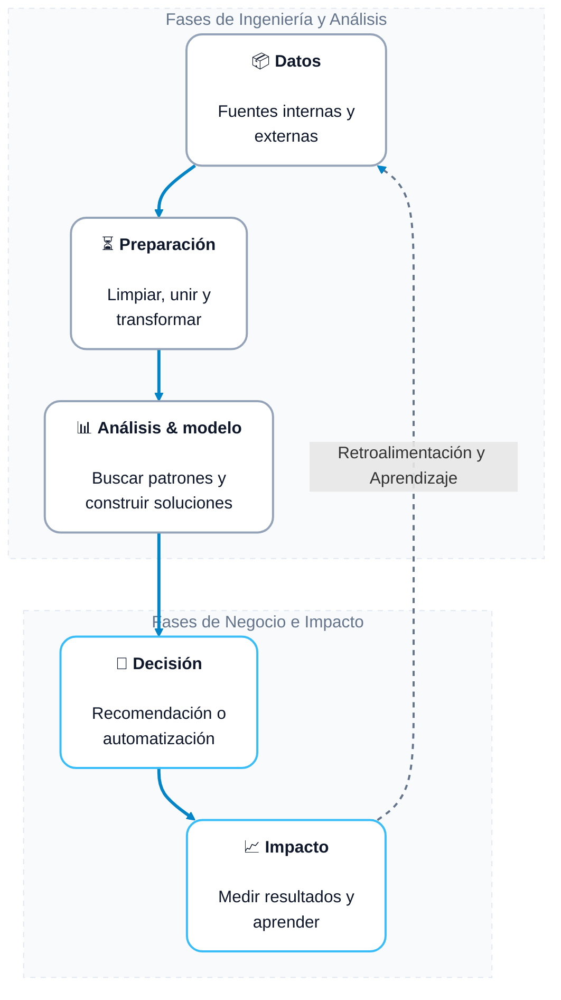
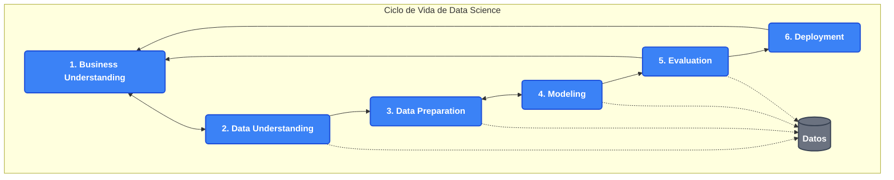

**AUTOR:** **[HADSON PAREDES](https://www.linkedin.com/in/hadson-paredes/) - 2026**

# Introducción a Data Science

## 1. ¿Qué es Data Science?
La **ciencia de datos** es un campo interdisciplinario que combina **matemáticas, estadística, programación y conocimiento del negocio** para extraer conocimientos valiosos a partir de datos estructurados y no estructurados.

* **Estadística:** Permite validar hipótesis y entender la distribución de los datos.
* **Programación:** Automatiza tareas y procesa grandes volúmenes de información (Big Data).
* **Conocimiento del negocio:** Traduce los hallazgos técnicos en decisiones estratégicas que aporten valor real.

## 2. Equipos, Metodologías y Ciclo de Vida de un Proyecto

### Roles Clave en el Equipo
* **Data Scientist (Científico de Datos):** Construye modelos predictivos y algoritmos de Machine Learning.
* **Data Engineer (Ingeniero de Datos):** Diseña, construye y mantiene las tuberías (pipelines) de extracción de datos.
* **Data Analyst (Analista de Datos):** Interpreta datos históricos y crea tableros visuales para el negocio.

### Ciclo de Vida del Proyecto (Metodología CRISP-DM)
* **Comprensión del negocio:** Definir el problema comercial y los objetivos estratégicos.
* **Comprensión de datos:** Recolectar, explorar e inspeccionar la información inicial disponible.
* **Preparación de datos:** Limpiar, transformar y estructurar los conjuntos finales de datos.
* **Modelado:** Seleccionar y aplicar algoritmos matemáticos y técnicas estadísticas avanzadas.
* **Evaluación:** Validar que los resultados del modelo cumplan estrictamente con las metas comerciales.
* **Despliegue:** Implementar el modelo en un entorno de producción para su uso continuo.

## 3. Herramientas, Lenguajes, Tipos de Datos, Python y Google Colab

### Tipos de Datos
* **Estructurados:** Datos organizados en tablas con filas y columnas bien definidas (ej. bases de datos SQL, archivos CSV).
* **No estructurados:** Información sin un formato predefinido (ej. correos electrónicos, imágenes, audios, publicaciones en redes sociales).

### Python y sus Librerías Esenciales
* **Python:** Lenguaje de programación líder en Data Science debido a su sintaxis simple y su robusto ecosistema de bibliotecas.
* **Pandas:** Herramienta fundamental para la manipulación, limpieza y análisis de datos tabulares.
* **NumPy:** Biblioteca para realizar operaciones matemáticas rápidas con matrices y arreglos numéricos masivos.
* **Matplotlib / Seaborn:** Librerías utilizadas para la generación de gráficos y la exploración visual de datos.
* **Scikit-Learn:** Herramienta estándar para implementar modelos clásicos de Machine Learning.

### Entorno de Trabajo: Google Colab
* **Google Colab:** Entorno de ejecución en la nube basado en cuadernos (Jupyter Notebooks).
* **Ventajas clave:** No requiere configuración ni instalación local, permite la colaboración en tiempo real y ofrece acceso gratuito a hardware de alto rendimiento como GPUs y TPUs.

---

# ¿Qué es Data Science?

**Data Science (Ciencia de Datos)** es una disciplina interdisciplinaria que combina matemáticas, estadística, inteligencia artificial y computación para analizar datos, obtener información útil y apoyar en la toma de decisiones estratégicas.

## 1. Los Tres Pilares Fundamentales

* **Ciencias de la Computación / TI (Computer Science / IT):** Aporta la infraestructura tecnológica. Incluye la programación, el manejo de bases de datos y las herramientas necesarias para procesar grandes volúmenes de información (Big Data).
* **Matemáticas y Estadística (Math and Statistics):** Constituye el fundamento teórico y analítico. Permite diseñar modelos, validar hipótesis, comprender la distribución de los datos y garantizar que las conclusiones sean válidas.
* **Conocimiento del Dominio / Negocio (Domains / Business Knowledge):** Representa el contexto práctico. Es crucial para entender el sector (como finanzas, salud o educación), formular las preguntas correctas y traducir los datos en soluciones reales.

## 2. Las Intersecciones del Diagrama

* **Machine Learning (Aprendizaje Automático):** 
  * *Unión de:* Ciencias de la Computación + Matemáticas y Estadística.
  * *Definición:* Creación de algoritmos que permiten a las computadoras aprender y hacer predicciones a partir de los datos de forma automatizada.
* **Desarrollo de Software (Software Development):** 
  * *Unión de:* Ciencias de la Computación + Conocimiento del Dominio.
  * *Definición:* Construcción de aplicaciones y herramientas informáticas diseñadas específicamente para resolver necesidades de una empresa o sector.
* **Investigación Tradicional (Traditional Research):** 
  * *Unión de:* Matemáticas y Estadística + Conocimiento del Dominio.
  * *Definición:* Análisis de datos clásico (común en el ámbito académico) enfocado en probar teorías o modelar situaciones sin requerir un desarrollo computacional intensivo.

## 3. El Núcleo: Data Science

La **Ciencia de Datos** se ubica en el centro exacto donde convergen todas estas áreas. Su verdadero valor radica en la capacidad de equilibrar la habilidad técnica, el rigor matemático y la visión de negocio para transformar datos brutos en decisiones inteligentes y automatizadas.

---

# Tipos de Análisis en Ciencia de Datos

La ciencia de datos evoluciona a través de cuatro etapas clave, respondiendo a preguntas que van desde entender el pasado hasta optimizar el futuro.

## 1. Análisis Descriptivo
> **Pregunta clave:** ¿Qué pasó?

* **Definición**: Consiste en examinar los datos históricos para entender el estado actual o los eventos pasados. Es la base de cualquier estrategia de datos.
* **Técnicas comunes**: Agregación de datos, minería de datos y visualización básica.
* **Herramientas**: Power BI, Tableau, Excel, SQL.
* **Ejemplo práctico**: Un informe mensual que muestra que las ventas disminuyeron un 15% en la región norte.

## 2. Análisis de Diagnóstico
> **Pregunta clave:** ¿Por qué pasó?

* **Definición**: Va un paso más allá del descriptivo para encontrar las causas subyacentes de un comportamiento o anomalía detectada.
* **Técnicas comunes**: Desglose de datos (drill-down), correlaciones, aislamiento de variables y análisis de causa raíz.
* **Herramientas**: R, Python (Pandas, SciPy), análisis estadístico inferencial.
* **Ejemplo práctico**: Descubrir que las ventas en el norte cayeron porque un competidor local abrió tres nuevas tiendas y lanzó una campaña de descuentos.

## 3. Análisis Predictivo
> **Pregunta clave:** ¿Qué podría pasar?

* **Definición**: Utiliza modelos estadísticos y algoritmos de aprendizaje automático para identificar la probabilidad de resultados futuros basándose en datos históricos.
* **Técnicas comunes**: Modelos de regresión, árboles de decisión, redes neuronales y series temporales.
* **Herramientas**: Python (Scikit-Learn, TensorFlow), herramientas de Cloud AI (AWS, Azure, GCP).
* **Ejemplo práctico**: Predecir que, si se mantienen las condiciones actuales, las ventas en el norte caerán un 5% adicional el próximo mes.

## 4. Análisis Prescriptivo
> **Pregunta clave:** ¿Qué conviene hacer?

* **Definición**: Es el nivel más avanzado. No solo predice el futuro, sino que aconseja sobre las acciones a tomar y muestra las implicaciones de cada decisión para maximizar los beneficios o mitigar riesgos.
* **Técnicas comunes**: Algoritmos de optimización, simulación de Montecarlo, sistemas de recomendación y motores de reglas de negocio.
* **Herramientas**: Gurobi, herramientas de simulación avanzada, sistemas personalizados de Inteligencia Artificial.
* **Ejemplo práctico**: Recomendar automáticamente reducir el precio del producto estrella en un 10% y redirigir el presupuesto publicitario digital hacia la región norte para recuperar el mercado.

---

# De Datos a Decisiones: Framework de Data Science

El valor real de la analítica no radica en acumular información, sino en transformarla en **acciones útiles y medibles** que impacten positivamente los resultados de una organización. A continuación, se detalla cada una de las fases del flujo de trabajo:

## 1. Datos
Esta etapa inicial consiste en la **recopilación y almacenamiento de activos informáticos** provenientes de múltiples fuentes.
* **Fuentes internas:** Sistemas ERP (como SAP), herramientas CRM (como Salesforce), bases de datos transaccionales, registros de compras o logs de aplicaciones web.
* **Fuentes externas:** Datos macroeconómicos públicos, información de competidores extraída mediante *web scraping*, datos meteorológicos o tendencias en redes sociales.
* **Estrategia clave:** Es fundamental definir qué datos son verdaderamente relevantes para el problema que se quiere resolver, evitando almacenar información innecesaria que solo genere ruido y costos de infraestructura.

## 2. Preparación
Conocida técnicamente como *Data Wrangling* o procesos **ETL** (Extracción, Transformación y Carga). Los datos crudos rara vez están listos para ser analizados de forma directa.
* **Limpiar:** Detectar y corregir anomalías como valores duplicados, registros nulos (datos faltantes) o errores de tipografía.
* **Unir:** Combinar tablas e información de diferentes formatos (por ejemplo, cruzar un archivo CSV con una base de datos SQL) utilizando llaves primarias o identificadores comunes.
* **Transformar:** Normalizar escalas numéricas, codificar variables categóricas (convertir texto a números) y estructurar la información. Esta fase suele consumir hasta el 80% del tiempo de un equipo de datos.

## 3. Análisis & Modelo
En este bloque se aplica el **núcleo matemático y estadístico** para extraer el conocimiento oculto en los datos previamente limpios.
* **Buscar patrones:** Uso de análisis exploratorio de datos (EDA) para entender correlaciones, tendencias históricas y comportamientos atípicos.
* **Construir soluciones:** Entrenamiento de modelos de Inteligencia Artificial y Aprendizaje Automático (*Machine Learning*). Dependiendo del objetivo, se desarrollan modelos predictivos (para anticipar qué pasará) o modelos prescriptivos (para sugerir qué hacer).

## 4. Decisión
El conocimiento técnico se traduce en **estrategias operativas o comerciales** comprensibles para los líderes del negocio.
* **Recomendación:** El modelo genera reportes, tableros de control (*dashboards*) o alertas para que un tomador de decisiones humano elija el camino óptimo (por ejemplo, ajustar el precio de un producto).
* **Automatización:** Los sistemas toman decisiones en tiempo real sin intervención humana. Ejemplos claros son los motores de recomendación de plataformas de *streaming* o los algoritmos de detección de fraudes bancarios.

## 5. Impacto
La fase final y el objetivo real de todo el ciclo: **evaluar el retorno de la inversión (ROI)** de la solución implementada.
* **Medir resultados:** Comparar el rendimiento actual del negocio contra una línea base anterior. Se evalúa si el modelo redujo costos, aumentó las ventas o mejoró la retención de usuarios a través de experimentos controlados (como los test A/B).
* **Aprender:** Monitorear el modelo de forma continua. Como el comportamiento del mercado cambia, los modelos tienden a perder precisión con el tiempo, por lo que este aprendizaje sirve para retroalimentar la fase inicial y reentrenar el sistema.

> 💡 **Idea clave:** Un proyecto de Data Science debe conectar una necesidad del negocio con una evidencia cuantitativa y una acción medible.

## Diagrama de flujo: De datos a desiciones

---

# Casos de Uso Frecuentes en Data Science

La Ciencia de Datos (**Data Science**) genera valor estratégico en las organizaciones dividiéndose en **tres grandes pilares analíticos**, cada uno con un impacto financiero y operativo directo según la industria.

## 1. Customer Analytics (Analítica de Clientes)
* **Impacto principal:** Impulsar los ingresos (**+50%** en nuevas oportunidades).
* **Objetivo:** Entender, atraer y retener al consumidor final de manera eficiente.

### Casos de uso específicos:
* **Customer Acquisition (Adquisición de Clientes):** Modelos predictivos para identificar prospectos de alto valor y optimizar el presupuesto de marketing.
* **Cross-sell / Upsell (Venta Cruzada y Escalonada):** Motores de recomendación que sugieren productos complementarios o de mayor valor según el comportamiento del usuario.
* **Offer Optimization (Optimización de Ofertas):** Personalización masiva de promociones y descuentos en tiempo real.
* **Retention & Loyalty (Retención y Fidelidad):** Modelos de *Churn* para anticipar qué clientes planean abandonar el servicio y activar campañas de contención.
* **Win back (Recuperación de Clientes):** Estrategias basadas en datos para reactivar a consumidores inactivos.
* **Channel / Mix Optimization (Optimización de Canales):** Análisis del rendimiento de canales (digitales y físicos) para maximizar el retorno de inversión (ROI).
* **Web Analytics (Analítica Web):** Monitoreo del comportamiento digital para mejorar la tasa de conversión en plataformas digitales.
* **Pricing Optimization (Optimización de Precios):** Algoritmos de precios dinámicos basados en la oferta, demanda, temporalidad y perfil del cliente.

## 2. Operational Analytics (Analítica Operacional)
* **Impacto principal:** Reducir costos operativos (ahorros proyectados del **-34%**).
* **Objetivo:** Maximizar la eficiencia interna, automatizar procesos y optimizar recursos.

### Casos de uso específicos:
* **Supply Chain Optimization (Optimización de la Cadena de Suministro):** Pronóstico avanzado de la demanda para mantener inventarios justos y eficientes.
* **Manufacturing Operations (Operaciones de Manufactura):** Control estadístico automatizado para reducir mermas y asegurar estándares de calidad en plantas de producción.
* **Asset Performance (Rendimiento de Activos):** Monitoreo del ciclo de vida y rendimiento de la infraestructura o maquinaria pesada.
* **Process Engineering & Capacity Planning (Ingeniería de Procesos):** Simulación de flujos de trabajo para dimensionar la cantidad correcta de personal y recursos necesarios.
* **Call Center Operations (Operaciones de Centros de Contacto):** Analítica de texto y voz (NLP) para evaluar la satisfacción del cliente y agilizar los tiempos de atención.
* **Retail Store Operations (Operaciones en Tiendas Minoristas):** Análisis de mapas de calor y tráfico peatonal para optimizar el diseño físico de las tiendas.
* **Predictive Maintenance (Mantenimiento Predictivo):** Uso de sensores IoT para anticipar fallas en los equipos antes de que ocurran, evitando paradas críticas.
* **IT Operations (Operaciones de TI):** Detección proactiva de caídas en servidores y balanceo inteligente de cargas en la nube.

## 3. Risk Analytics (Analítica de Riesgos)
* **Impacto principal:** Evitar riesgos (incremento del **+46%** en la rentabilidad mediante la prevención).
* **Objetivo:** Proteger la salud financiera, legal, digital y reputacional de la empresa.

### Casos de uso específicos:
* **Credit Scoring (Calificación Crediticia):** Evaluación en segundos del perfil de riesgo de un cliente para la aprobación de créditos o financiamientos.
* **Insurance Underwriting (Suscripción de Seguros):** Modelado predictivo de siniestros para fijar primas de seguros justas y personalizadas.
* **Capital Planning & Stress Testing (Planificación de Capital):** Modelos de simulación económica para prever la solidez financiera ante escenarios de crisis.
* **Fraud Detection (Detección de Fraude):** Algoritmos de Machine Learning que identifican y bloquean transacciones bancarias sospechosas en milisegundos.
* **Anti-Money Laundering (Antilavado de Dinero):** Monitoreo de patrones de movimiento de capitales para detectar lavado de activos.
* **Rogue Trading (Operaciones Bursátiles No Autorizadas):** Vigilancia interna de comportamientos anómalos o maliciosos en operadores de bolsa.
* **Cyber Security (Ciberseguridad):** Detección temprana de intrusiones en la red corporativa mediante análisis de comportamiento anómalo de datos.
* **Compliance (Cumplimiento Normativo):** Automatización y auditoría de datos para cumplir de manera estricta con las leyes y regulaciones locales.

## Industrias y Sectores de Aplicación Transversal

La analítica de datos explicada anteriormente se cruza de forma directa en los siguientes sectores del mercado:

* 🚗 **Automotive / Manufacturing:** Mantenimiento predictivo, optimización de líneas de ensamble y desarrollo de vehículos autónomos.
* 🏦 **Banking / Insurance:** Scoring para créditos, prevención de fraudes masivos y análisis de riesgos financieros.
* 🏥 **e-Health / Life Sciences:** Medicina de precisión, diagnóstico preventivo mediante imágenes y optimización de recursos hospitalarios.
* 🛒 **Retail / Consumer Goods / Telco / Utilities:** Logística de última milla, precios dinámicos, retención de clientes y predicción de la demanda energética.
* 🏛️ **Government:** Detección de evasión fiscal, diseño de políticas públicas eficientes y mejora en la atención ciudadana.
* ✈️ **Travel, Transport & Logistics:** Optimización de rutas de transporte, gestión de flotas y tarifas dinámicas en aerolíneas u hoteles.

## Beneficios del Data Science en los Negocios

La **ciencia de datos (Data Science)** resuelve problemas críticos de negocio al transformar datos brutos en información estratégica, aportando un alto valor competitivo mediante estadísticas y algoritmos avanzados.

### 1. Reducir riesgo y errores
* **Modelos predictivos**: Previenen fraudes financieros antes de que ocurran.
* **Mantenimiento predictivo**: Detectan fallas en maquinaria industrial a tiempo.
* **Control de calidad**: Minimizan errores de producción de forma automatizada.

### 2. Entender mejor a clientes y procesos
* **Segmentación avanzada**: Agrupa clientes por comportamientos de compra específicos.
* **Análisis de sentimiento**: Evalúa la opinión pública en redes sociales.
* **Minería de procesos**: Identifica cuellos de botella en la operación diaria.

### 3. Automatizar tareas de análisis
* **Pipelines de datos**: Limpian y procesan información sin intervención humana.
* **Algoritmos de aprendizaje**: Clasifican millones de registros en pocos segundos.
* **Reportes automáticos**: Actualizan métricas clave de negocio de inmediato.

### 4. Encontrar oportunidades de crecimiento
* **Sistemas de recomendación**: Sugieren productos personalizados para elevar las ventas.
* **Modelado de demanda**: Predice necesidades futuras del mercado objetivo.
* **Análisis geoespacial**: Descubre ubicaciones óptimas para expandir el negocio.

### 5. Mejorar la toma de decisiones
* **Análisis descriptivo**: Diagnostica el estado actual de la empresa con precisión.
* **Simulaciones estadísticas**: Evalúan escenarios de riesgo antes de invertir capital.
* **Tableros interactivos**: Facilitan el acceso visual a métricas clave corporativas.

---

# Tendencias Actuales en Data Science

Hoy en día, el campo de la ciencia de datos se mueve hacia soluciones más rápidas, colaborativas y apoyadas por Inteligencia Artificial (IA). A continuación, se presenta una ampliación de las cinco tendencias clave identificadas:

## 1. IA Generativa
* **Definición:** Modelos avanzados de aprendizaje automático capaces de crear contenido nuevo y original, como texto, imágenes o código, a partir de patrones aprendidos en grandes volúmenes de datos.
* **Apoyo en código:** Asistentes virtuales y herramientas de autocompletado automatizan la escritura de scripts en Python, R o SQL, optimizando el tiempo de desarrollo y la corrección de errores.
* **Documentación y análisis:** Facilita la generación automática de reportes técnicos, comentarios en el código y resúmenes de datos complejos para audiencias comerciales o no técnicas.

## 2. MLOps (Operaciones de Machine Learning)
* **Definición:** Conjunto de prácticas y herramientas que fusionan el desarrollo de modelos de Machine Learning con las operaciones de software tradicionales (DevOps).
* **De notebooks a producción:** Permite llevar los modelos desde entornos de experimentación e investigación (como Jupyter Notebooks) hacia sistemas de producción listos para el usuario final.
* **Soluciones reproducibles:** Garantiza que los modelos puedan ser entrenados, probados y desplegados de forma estandarizada, facilitando el control de versiones de datos y códigos.

## 3. Tiempo Real
* **Definición:** Capacidades técnicas para procesar, analizar y extraer valor de la información en el mismo milisegundo en que esta es generada.
* **Datos streaming:** Uso de plataformas de mensajería y almacenamiento continuo (como Apache Kafka) para gestionar flujos constantes e ininterrumpidos de datos de sensores, clics o transacciones.
* **Decisiones más rápidas:** Permite una reacción empresarial inmediata ante eventos críticos, como la detección instantánea de fraudes financieros o la actualización de precios dinámicos.

## 4. Multimodal
* **Definición:** Arquitecturas de IA entrenadas para interpretar, conectar y operar con diferentes tipos de señales de datos de manera simultánea.
* **Un mismo flujo:** Integra fuentes de texto, imágenes, archivos de audio y video dentro de un único pipeline de procesamiento de datos.
* **Aplicación:** Facilita la creación de sistemas más contextuales, como herramientas de diagnóstico médico que analizan tanto el historial clínico escrito como las imágenes de una radiografía.

## 5. IA Responsable
* **Definición:** Marco ético y metodológico diseñado para asegurar que el diseño, desarrollo y despliegue de soluciones de IA sea transparente, justo y seguro.
* **Privacidad y uso seguro:** Implementación de técnicas como el cifrado homomórfico y la privacidad diferencial para proteger la identidad y los datos confidenciales de los usuarios.
* **Sesgos:** Auditoría y monitoreo constante de los datos de entrenamiento para identificar y mitigar discriminaciones algorítmicas por motivos de género, raza o nivel socioeconómico.

## El Ecosistema de la Ciencia de Datos: Más allá del Modelado

**El modelado en ciencia de datos e inteligencia artificial no es un proceso aislado**, sino que depende de un ecosistema integral que abarca desde la preparación de la información hasta la puesta en producción. 

### Más allá del modelado
El modelado (crear algoritmos o redes neuronales) es solo una pequeña fracción del ciclo de vida de un proyecto de datos. Enfocarse únicamente en el algoritmo suele llevar al fracaso del proyecto si no se consideran las etapas previas y posteriores.

### La importancia de la comunicación
* **Traducción de negocio:** Un científico de datos debe ser capaz de traducir un problema técnico complejo en soluciones e impactos de negocio comprensibles para directivos y clientes.
* **Alineación de objetivos:** Garantiza que el modelo que se está construyendo realmente resuelva la necesidad principal de la empresa y no un problema inexistente.
* **Narración de datos (*Data Storytelling*):** Explicar cómo funciona el modelo y por qué toma ciertas decisiones ayuda a generar confianza en los usuarios finales.

### Calidad del dato (*Data Quality*)
Existe una regla fundamental en la analítica: *"Basura entra, basura sale" (Garbage in, garbage out)*. Si los datos están corruptos o sesgados, el modelo no servirá.
* **Consistencia y limpieza:** Implica eliminar duplicados, corregir valores nulos, normalizar formatos y detectar valores atípicos (*outliers*).
* **Gobernanza:** Asegurar la trazabilidad del dato, es decir, saber de dónde viene, quién lo modificó y si cumple con las normativas de privacidad.

### Experimentación constante
El desarrollo de modelos es un proceso empírico y científico.
* **Prueba de hipótesis:** Probar diferentes algoritmos (desde regresiones simples hasta aprendizaje profundo) y combinaciones de variables para ver cuál funciona mejor.
* **Métricas de evaluación:** Analizar los resultados usando indicadores específicos (como precisión, *recall*, F1-score o error cuadrático medio) según el objetivo del proyecto.
* **Control de versiones:** Registrar cada experimento (usando herramientas como MLflow o DVC) para poder replicar los resultados exitosos en el futuro.

### Implementación (*Deployment* y MLOps)
Un modelo solo aporta valor real cuando sale del entorno de desarrollo y se integra en el mundo real.
* **Puesta en producción:** Convertir el modelo en una API o servicio que pueda consumir una aplicación web, móvil o un sistema empresarial en tiempo real o por lotes (*batch*).
* **Monitoreo:** Supervisar el rendimiento del modelo de forma continua para detectar el "desgaste del modelo" (*data drift*), que ocurre cuando las condiciones del mundo real cambian y el algoritmo empieza a perder precisión.

---

# Roles Clave en el Equipo de Data Scoemce

A continuación, se presenta una ampliación detallada de cada uno de los roles y conceptos clave mencionados en la imagen, explicando a fondo sus funciones, interacciones y el valor que aportan a un proyecto de ciencia de datos:

## 1. Negocio & Product Owner: El Puño Estratégico

Este rol actúa como el puente entre las necesidades comerciales y el equipo técnico. Su objetivo principal es asegurar que el proyecto resuelva un problema real y genere un retorno de inversión.

* **Definición del Problema:** No se trata de aplicar tecnología porque sí. El Product Owner traduce una necesidad abstracta (por ejemplo, "estamos perdiendo clientes") en una pregunta analítica (¿cómo podemos predecir qué clientes se darán de baja el próximo mes?).
* **Medición de Valor:** Define las métricas de éxito del negocio, como el incremento en ventas, la reducción de costos o la optimización del tiempo.
* Alineación de Objetivos: Prioriza el trabajo del equipo para garantizar que los desarrollos técnicos se traduzcan en soluciones prácticas para la empresa.

## 2. Data Analyst: El Explorador de la Información

El analista de datos se enfoca en el pasado y el presente. Su misión es examinar los datos históricos para entender qué ha sucedido y por qué.

* Exploración de Datos (EDA): Limpia, filtra y transforma bases de datos para encontrar anomalías, tendencias y correlaciones iniciales.
* Construcción de Insights: Traduce los datos en conocimiento accionable. Descubre patrones de comportamiento que no son visibles a simple vista (por ejemplo, identificar que las ventas caen siempre a una hora específica del día).
* Visualización y Reportes: Utiliza herramientas visuales (como tableros interactivos) para que los líderes del negocio puedan entender la situación de la empresa de forma rápida y sencilla.

## 3. Data Scientist: El Arquitecto Predictivo

El científico de datos toma la posta del analista para enfocarse en el futuro. Utiliza matemáticas, estadística avanzada y programación para predecir escenarios y automatizar decisiones.

* Modelado Avanzado: Diseña y entrena algoritmos de Machine Learning (Aprendizaje Automático) y Deep Learning para realizar predicciones precisas.
* Experimentación Constante: Prueba diferentes hipótesis, variables y arquitecturas de modelos bajo metodologías científicas para encontrar la solución con mayor exactitud.
* Validación de Resultados: Implementa pruebas rigurosas para asegurarse de que el modelo matemático no solo funcione con los datos del pasado, sino que sea capaz de acertar con datos nuevos y reales en el día a día.

## 4. Data Engineer: El Constructor de la Infraestructura

Sin ingeniería de datos, los analistas y científicos no tendrían materia prima con la cual trabajar. Este rol se encarga de la arquitectura, almacenamiento y flujo de la información.

* Preparación de Pipelines (Tuberías de Datos): Diseña sistemas automatizados (procesos ETL/ELT) que extraen datos de múltiples fuentes (aplicaciones, webs, sensores), los transforman y los depositan en un solo lugar.
* Garantía de Datos Confiables: Implementa controles de calidad para asegurar que los datos no lleguen duplicados, corruptos o incompletos, manteniendo la integridad del sistema.
* Escalabilidad y Rendimiento: Configura bases de datos y entornos en la nube que permiten procesar millones de registros en segundos, garantizando la estabilidad técnica del proyecto.

## 5. Stakeholders: Los Consumidores de Valor

Son los actores interesados en el proyecto, usualmente directivos, gerentes de área o clientes finales que financian e impulsan la iniciativa.

* Uso de Resultados: Adoptan los modelos y tableros desarrollados por el equipo técnico dentro de su flujo diario de trabajo.
* Toma de Decisiones: Utilizan la evidencia basada en datos para mitigar riesgos, definir presupuestos, lanzar nuevos productos o cambiar el rumbo estratégico de la compañía.

## El Pilar Fundamental: Más Allá de la Tecnología
Como destaca el recuadro "Importante!!!" de la imagen, un error común es pensar que el éxito de la Data Science radica únicamente en escribir código complejo o usar modelos avanzados. Un proyecto exitoso requiere equilibrio:

* Entender el Contexto: Cada sector (salud, finanzas, educación) tiene sus propias reglas. Los datos cobran sentido únicamente cuando se analiza el entorno en el que se generan.
* Comunicación Clara: El mejor modelo predictivo del mundo es inútil si el equipo técnico no sabe explicar cómo funciona y qué ventajas ofrece a quienes toman las decisiones de negocio.

¿Qué aspecto te gustaría profundizar ahora? Podemos revisar las herramientas de software que utiliza cada rol, o diseñar un flujo paso a paso de cómo cooperan todos en un proyecto real.

---

# Metodologías para Trabajar en Proyectos de Datos

En el desarrollo de proyectos analíticos y de ciencia de datos, la estructura es fundamental para reducir errores y optimizar tiempos. Dos de los enfoques más utilizados y complementarios son **CRISP-DM** y el **Trabajo Ágil (Agile)**.

---

## 1. CRISP-DM (Cross-Industry Standard Process for Data Mining)

Es el **estándar de la industria más utilizado** para guiar proyectos de minería de datos, analítica avanzada y Machine Learning. Su éxito radica en que conecta los datos directamente con las necesidades estratégicas de la empresa.

### Las 6 Etapas del Ciclo CRISP-DM

* **Comprensión del negocio:** Definir el problema a resolver desde la perspectiva empresarial y establecer los criterios de éxito del proyecto.
* **Comprensión de los datos:** Recolectar los datos iniciales, explorar sus propiedades básicas e identificar problemas de calidad (como datos faltantes o inconsistencias).
* **Preparación de los datos:** Seleccionar, limpiar, transformar y estructurar las fuentes de datos para construir el conjunto final que alimentará los modelos.
* **Modelado:** Aplicar técnicas estadísticas y algoritmos de Machine Learning (regresiones, árboles de decisión, redes neuronales) y calibrar sus parámetros.
* **Evaluación:** Analizar si el modelo cumple rigurosamente con los objetivos de negocio planteados en la primera fase antes de su producción.
* **Despliegue:** Implementar el modelo en un entorno real (mediante una API, software o reporte interactivo) para que el usuario final pueda tomar decisiones.

## 2. Trabajo Ágil (Agile)

Las metodologías ágiles (como **Scrum** o **Kanban**) se adaptan a la analítica de datos para gestionar la incertidumbre y la naturaleza experimental de los proyectos mediante entregas rápidas y constantes.

### Características Clave

* **Ciclos cortos (Sprints):** El trabajo se divide en periodos fijos (de 1 a 3 semanas) con objetivos de entrega muy específicos.
* **Feedback frecuente:** Se muestran avances continuos a los interesados del negocio para validar hipótesis y ajustar el rumbo rápidamente.
* **Productos Mínimos Viables (MVP):** En lugar de esperar meses por un modelo perfecto, se entrega una versión básica funcional y se mejora de forma iterativa.
* **Entornos colaborativos:** Se apoya en herramientas de experimentación y gestión visual como notebooks de código (Jupyter), tableros de tareas (Jira, Trello) y prototipos dinámicos.

## Comparativa y Coexistencia

En entornos profesionales, **CRISP-DM y Agile no son excluyentes, sino complementarios**. CRISP-DM define *qué* pasos científicos se deben seguir, mientras que Agile define *cómo* se organiza el equipo para ejecutarlos de forma eficiente.

| Aspecto | CRISP-DM | Trabajo Ágil |
| :--- | :--- | :--- |
| **Aporte principal** | El mapa de ruta técnico y metodológico. | El ritmo de trabajo y la gestión del equipo. |
| **Enfoque** | Rigor científico y calidad del análisis de datos. | Adaptabilidad, flexibilidad y entrega de valor continuo. |
| **Herramientas comunes** | Algoritmos, código SQL/Python, pipelines de datos. | Tableros Kanban, reuniones diarias, sprints. |

---

# Ciclo de Vida de un Proyecto de Data Science (Metodología CRISP-DM)

El proceso estándar de la industria para el desarrollo de proyectos de ciencia de datos y minería de datos (*Cross-Industry Standard Process for Data Mining*) se divide en seis fases cíclicas e interconectadas:

## 1. Comprensión del Negocio (*Business Understanding*)
* **Objetivo:** Definir el problema desde la perspectiva empresarial.
* **Acciones clave:**
  * Determinar los objetivos comerciales y los criterios de éxito.
  * Evaluar la situación actual (recursos, requisitos y riesgos).
  * Traducir las metas de negocio en un problema técnico de Ciencia de Datos.

## 2. Comprensión de los Datos (*Data Understanding*)
* **Objetivo:** Familiarizarse con la información disponible y detectar problemas iniciales.
* **Acciones clave:**
  * Recolectar los datos iniciales de las fuentes disponibles.
  * Explorar las propiedades de los datos (volumen, formatos, tipos de variables).
  * Evaluar la calidad de los datos (identificar valores nulos, atípicos o erróneos).

## 3. Preparación de los Datos (*Data Preparation*)
* **Objetivo:** Construir el conjunto de datos final que se introducirá en los modelos.
* **Acciones clave:**
  * Limpiar los datos (manejo de valores faltantes y corrección de errores).
  * Seleccionar las variables y filas relevantes para el análisis.
  * Transformar y estructurar la información (creación de nuevas variables, normalización).
  * Combinar o integrar múltiples fuentes de datos.

## 4. Modelado (*Modeling*)
* **Objetivo:** Seleccionar y aplicar las técnicas matemáticas y algorítmicas adecuadas.
* **Acciones clave:**
  * Seleccionar los algoritmos de Machine Learning idóneos (regresión, clasificación, clustering, etc.).
  * Generar el diseño de pruebas para validar la eficacia del modelo.
  * Entrenar los modelos y ajustar sus hiperparámetros para optimizar el rendimiento.

## 5. Evaluación (*Evaluation*)
* **Objetivo:** Garantizar que el modelo desarrollado cumpla con las expectativas del negocio.
* **Acciones clave:**
  * Evaluar los resultados del modelo frente a los objetivos comerciales definidos en la fase 1.
  * Revisar el proceso completo para asegurar que no se hayan omitido detalles importantes.
  * Decidir si el modelo está listo para producción o si requiere iterar nuevamente en fases previas.

## 6. Despliegue (*Deployment*)
* **Objetivo:** Organizar y presentar los resultados para que el usuario final los aproveche.
* **Acciones clave:**
  * Implementar el modelo en un entorno de producción (integración en aplicaciones o APIs).
  * Diseñar reportes automatizados, alertas o tableros de control (*dashboards*).
  * Establecer un plan de monitoreo y mantenimiento continuo para evitar la degradación del modelo.

## La Ciencia de Datos como un Proceso No Lineal

El concepto clave de la imagen destaca que **la ciencia de datos es un proceso iterativo y no lineal**. Esto significa que es completamente normal, común y necesario retroceder a etapas anteriores a medida que se avanza y se descubre nueva información en un proyecto.

### ¿Por qué el camino no es lineal?

En la práctica, un científico de datos rara vez avanza del punto A al punto B en línea recta. El desarrollo se parece más a un bucle de mejora continua debido a tres factores principales:

* **Exploración de datos (EDA):** Al analizar los datos por primera vez, se suelen descubrir inconsistencias, valores nulos o sesgos. Esto obliga a regresar a la etapa de recolección o limpieza de datos para corregir los problemas antes de intentar entrenar cualquier modelo.
* **Evaluación del modelo:** Si al probar un algoritmo de *Machine Learning* los resultados de precisión o error no son los esperados, el equipo debe retroceder. Esto implica probar nuevas arquitecturas, ajustar hiperparámetros o realizar una nueva ingeniería de variables (*feature engineering*).
* **Feedback del negocio:** Los modelos deben resolver un problema comercial real. Si los líderes de negocio revisan los resultados iniciales y cambian los objetivos, o si se dan cuenta de que las restricciones del mercado son distintas, el proyecto debe reestructurarse desde la definición del problema.

### Metodologías que respaldan la no linealidad

Para gestionar este flujo de trabajo flexible, el sector de la analítica utiliza marcos específicos:

#### CRISP-DM (*Cross-Industry Standard Process for Data Mining*)
Es el modelo más clásico y utilizado. Sus fases están conectadas por flechas bidireccionales. Por ejemplo, la fase de *Evaluación* determina directamente si el modelo está listo para el despliegue o si se debe volver al inicio (*Comprensión del Negocio*).

#### Metodologías Ágiles (*Scrum / Kanban*)
Adaptadas a la ciencia de datos, permiten trabajar en ciclos cortos llamados *Sprints*. Al final de cada ciclo, se presenta un Producto Mínimo Viable (MVP) para recibir feedback rápido del negocio y pivotar de inmediato si es necesario.

### 💡 Beneficios de aceptar la no linealidad

* **Reduce la frustración:** Entender que "volver atrás" es parte del diseño del trabajo alivia la presión sobre los equipos técnicos.
* **Ahorra costes:** Detectar un error de concepto gracias al feedback temprano evita gastar meses de desarrollo en un modelo que no se va a utilizar.
* **Mejora la calidad:** Cada ciclo de retroalimentación refina el entendimiento de los datos, produciendo soluciones mucho más robustas y alineadas con la realidad.

## 7. Diagrama del ciclo de vida

# Buenas Prácticas al Iniciar un Proyecto en Data Science

> **Nota clave:** Antes de correr un modelo, conviene alinear expectativas y criterios de éxito.

## Checklist Inicial

Este bloque se enfoca en establecer las bases fundamentales antes de escribir cualquier línea de código o procesar datos.

* **Definir claramente el problema de negocio:** Consiste en traducir una necesidad u objetivo comercial en una pregunta técnica. No se trata solo de aplicar tecnología, sino de entender qué valor real generará el proyecto para la empresa (por ejemplo, reducir la fuga de clientes o optimizar el inventario).
* **Acordar una métrica de éxito:** Es indispensable establecer cómo se medirá si el proyecto funcionó. Se deben alinear tanto las métricas técnicas (como la precisión o el error del modelo) como las métricas de negocio (como el porcentaje de ahorro económico o el incremento en la conversión).
* **Validar la calidad y disponibilidad del dato:** Antes de avanzar, se debe auditar si los datos necesarios realmente existen, si se tiene acceso técnico a ellos y si su calidad es suficiente (evaluar datos faltantes, duplicados o errores de registro) para entrenar un modelo confiable.
* **Empezar simple y luego iterar:** El mejor enfoque es construir primero un Producto Mínimo Viable (MVP) utilizando un modelo base o reglas de negocio simples. Una vez que este sistema básico funcione de extremo a extremo, se introduce mayor complejidad de forma gradual.

## Checklist Complementario

Este bloque asegura la sostenibilidad, la ética y la correcta adopción del proyecto a largo plazo dentro de la organización.

* **Documentar supuestos y decisiones:** Durante el desarrollo se toman múltiples decisiones de diseño (por qué se usó cierta variable, qué filtros se aplicaron, etc.). Registrar esto evita que el conocimiento se pierda y facilita futuras auditorías o actualizaciones.
* **Comunicar hallazgos con lenguaje claro:** Los líderes de negocio o clientes finales rara vez entienden tecnicismos matemáticos complejos. El rol del equipo técnico es traducir los datos en narrativas visuales y conclusiones accionables para la toma de decisiones.
* **Pensar desde temprano en implementación:** Un modelo que solo funciona en la computadora del científico de datos no genera valor. Desde el día uno se debe planificar cómo se integrará en los sistemas de producción de la empresa (frecuencia de actualización, APIs, infraestructura, etc.).
* **Revisar riesgos, sesgos y privacidad:** Es crítico evaluar si los datos de entrenamiento discriminan a ciertos grupos de personas (sesgos), garantizar el cumplimiento de normativas de protección de datos personales y prever planes de contingencia si el modelo falla.

## Evitando el Error Común

El error destacado en la imagen es uno de los tropiezos más costosos en la ciencia de datos: **ir directo al modelado sin entender el problema o la calidad de los datos**. Esto genera modelos poco útiles, difíciles de explicar o imposibles de implementar (*Garbage In, Garbage Out*).

A continuación, se detalla el flujo de trabajo correcto basado en las mejores prácticas de la industria:

### 1. Entendimiento del Negocio y del Problema
Antes de escribir código, es obligatorio definir el rumbo estratégico del proyecto.
* **Definición del objetivo:** Traducir una necesidad comercial (ej. *«queremos vender más»*) en un problema analítico medible (ej. *«predecir qué clientes tienen mayor probabilidad de fuga»*).
* **Métricas de éxito:** Establecer si el éxito se medirá con métricas técnicas (como *Precision*, *Recall* o *F1-Score*) o con impacto financiero (ROI).
* **Validación de viabilidad:** Confirmar que el problema realmente se pueda resolver con los datos disponibles.

### 2. Análisis Exploratorio de Datos (EDA) y Calidad del Dato
Esta fase diagnostica la "salud" de tu información antes de que entre al algoritmo.
* **Gestión de datos faltantes:** Decidir de forma justificada si se van a eliminar registros o aplicar técnicas de imputación (relleno de valores).
* **Detección de valores atípicos (*Outliers*):** Evaluar si los datos extremos son errores de captura o anomalías reales del negocio que el modelo debe aprender.
* **Consistencia de tipos:** Asegurar formatos correctos (ej. fechas, números, categorías) y eliminar duplicados que sesguen el entrenamiento.

### 3. Ingeniería de Características (*Feature Engineering*)
Un algoritmo simple con excelentes variables siempre superará a un algoritmo complejo con variables mediocres.
* **Creación de valor:** Combinar datos existentes para generar nuevos indicadores más potentes (ej. transformar una «fecha de nacimiento» en la variable «edad»).
* **Transformación y escalado:** Normalizar variables numéricas y codificar variables categóricas según los requerimientos del algoritmo seleccionado.

### 4. Selección y Entrenamiento del Modelo
El modelado es el paso final de la preparación, no el inicial.
* **Modelos base (*Baseline*):** Iniciar siempre con un modelo simple (ej. regresión logística o árbol de decisión) para tener un punto de comparación inicial.
* **Prevención del sobreajuste (*Overfitting*):** Utilizar técnicas de validación cruzada (*Cross-Validation*) para garantizar que el modelo generalice correctamente con datos nuevos del mundo real.

### 5. Interpretabilidad e Implementación (*Despliegue*)
Un modelo que no se puede explicar o que no se puede integrar en producción no genera ningún valor para la organización.
* **Explicabilidad:** Utilizar herramientas como SHAP o LIME para entender los factores que determinan las predicciones, algo crítico en sectores regulados como finanzas o salud.
* **Arquitectura de producción:** Diseñar el modelo junto a equipos de MLOps para asegurar que sea viable implementarlo en los sistemas de la empresa (vía APIs o procesamiento en lotes).

### Sígueme en mis redes sociales

> Publicaciones semanales...!

 
 

